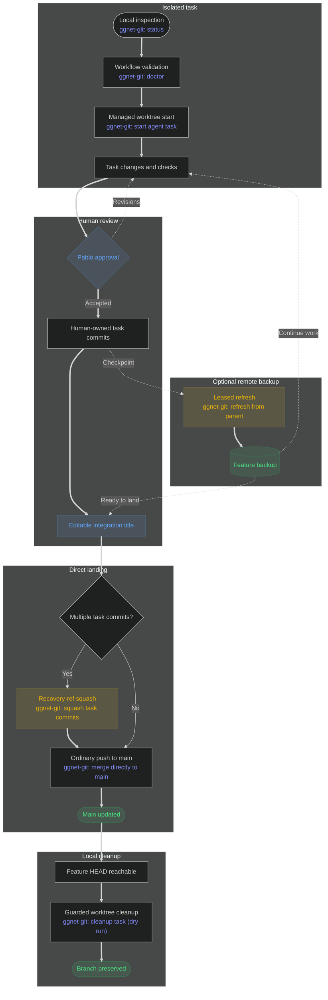

# Contributing to GGNet

The repository-wide authority and coding contract is [`AGENTS.md`](AGENTS.md).
This guide describes the implemented local Git/worktree workflow; it does not
grant agents commit authority or settle release policy.

## Setup

Install the .NET SDK pinned by `global.json`, Git, and the GitHub CLI. The
local gates — the same ones CI runs — are:

```sh
dotnet build GGNet.slnx -warnaserror
dotnet test GGNet.slnx
dotnet format whitespace GGNet.slnx --verify-no-changes
dotnet format style GGNet.slnx --verify-no-changes
```

See [`README.md`](README.md) for the library itself.

## GGNet is a pinned dependency

tsu and ziggy-brew consume GGNet as a git submodule pinned at the tip of
`main`, and their own `refresh` advances that pin to whatever lands here. A
change that breaks a consumer — a public API change, a package version, a
shared build file such as `Directory.Build.props` or `Directory.Packages.props`
— is finished only when every consumer builds against it: name it in the task
handoff so the consumer's follow-up task can fix the consumer.

## Task ownership

Keep one task, one branch, one worktree, and one active owner. New task
worktrees are isolated from the primary checkout so human and agent changes do
not collide.

For AI-assisted tasks, the agent edits and verifies the worktree. Pablo reviews
the completed diff, chooses what to stage, owns the commit, and decides whether
and when to publish or land it.

The primary commands below are available through `.vscode/tasks.json` and
directly through `.vscode/scripts/git-flow.sh`. Optional diagnostics without a
task are identified as CLI-only.

## The base branch

Every command takes its base from the branch the remote's default HEAD names,
`refs/remotes/origin/HEAD`, read on each run; nothing configures it. In GGNet
that branch is `main` (renamed from `master` on 2026-10-13), and this guide
writes `origin/main` for the base. When `origin/HEAD` is unresolved, `doctor`
reports an error and every command that needs the base refuses before fetching,
printing the repair:

```sh
git remote set-head origin --auto
```

The same command repairs a clone whose `origin/HEAD` still names a branch the
remote has since renamed — a GGNet clone made before the rename still names
`master`. Git never retargets an existing `origin/HEAD` on its own, so every
command that contacts the remote compares it with the remote's own default
branch after fetching, and refuses a stale one with that repair. Pin
publication checks each submodule's `origin/HEAD` the same way before pushing to
it.

## Workflow at a glance



## Inspect before acting

```sh
./.vscode/scripts/git-flow.sh status
./.vscode/scripts/git-flow.sh doctor
```

VS Code tasks: [`ggnet-git: status`](.vscode/tasks.json#L99) and
[`ggnet-git: doctor`](.vscode/tasks.json#L112).

`status` reports registered worktrees, branches, local ahead/behind state, and
provenance. `doctor` validates required tools, base refs, registrations, and
workflow assumptions. Both are read-only and use local refs only: neither
fetches nor calls GitHub.

## Start or resume a task

```sh
./.vscode/scripts/git-flow.sh start <branch>
./.vscode/scripts/git-flow.sh resume <branch>
```

VS Code task:
[`ggnet-git: start agent task`](.vscode/tasks.json#L125), which invokes the
guarded `agent-start` alias.

`start` must fetch `origin` successfully, resolves an explicit `origin/main`
commit, and creates a new branch in an isolated worktree. It does not switch,
pull, or edit the primary checkout. A slash-containing branch remains one
collision-resistant directory component beneath the reserved managed root.

`resume` is an optional CLI-only diagnostic with no VS Code task. It locates
the branch through Git's registered worktree data, but never reconstructs a
path or creates a replacement worktree.

The compatibility alias `agent-start` reaches the same guarded start behavior.

### Managed-worktree provenance

A worktree is workflow-managed only when both of these signals agree:

1. its exact registered path is contained by the reserved managed root; and
2. a matching `git-flow-managed` file in its per-worktree Git-admin directory
   records its branch and selected base reference and commit.

The default root is `<primary-parent>/<repository>-worktrees` (for GGNet,
`GGNet-worktrees` beside the primary checkout); a deliberate repository-local
`git-flow.managedRoot` setting may select another absolute, reserved root. A
missing, malformed, or contradictory signal makes provenance unknown. The
workflow does not adopt existing sibling worktrees, and cleanup fails closed
instead of guessing ownership.

## Optional handoff diagnostic and commit ownership

```sh
./.vscode/scripts/git-flow.sh handoff
./.vscode/scripts/git-flow.sh handoff --verification "dotnet test: passed" --concern "review the re-pinned goldens"
```

There is intentionally no VS Code task for `handoff`; it is an optional
CLI-only diagnostic.

`handoff` reports the worktree, branch, provenance, selected base, HEAD,
changed files, diff summary, supplied verification, unresolved concerns, and
the provisional integration title. It does not stage, commit, fetch, push, or
call GitHub.

The first task commit subject is a placeholder for the provisional integration
title, not an immutable final message. The later `squash` and `merge` prompts
let Pablo keep it by pressing Enter or replace it after reviewing the complete
diff.

## Submodules in a task

GGNet has no submodules today; it *is* the submodule in its consumers. The
workflow still handles them generically, so this is what a submodule added
here would get.

`start` initializes submodules in every new worktree, checked out detached at
the pinned commit; their git stores are per-worktree, so their local commits
exist only inside that worktree until published. Editing library files is
ordinary task work: commit inside the submodule first, then stage the pin bump
in the superproject task commit. `status` reports a `submodules:` line per
worktree — `clean`, `dirty`, or `unpublished` — and `doctor` flags unpublished
submodule commits by name.

Publishing commands handle the rest: `refresh` and `merge` first
fast-forward-publish any submodule commits the outgoing superproject commits
pin (an ordinary push to the submodule's default branch), then push the
superproject with `--recurse-submodules=check` as the final guard. A pin that
does not fast-forward the submodule's default branch fails closed with a
divergence report and is never forced.

Dependencies stay at their latest. After its publication, `refresh` advances
every initialized, clean submodule to the tip of the branch `.gitmodules` names
for it with `git submodule update --remote`, and reports
`advanced submodule: <path> <old>..<new>` or that the submodule is already at
the tip. The new pin is left uncommitted: commit it in the task with whatever
consumer fixes it needs, because the next `refresh` refuses the dirty worktree
until you do. A dirty or unpublished submodule is named and not advanced.

`doctor` warns, without failing, when a worktree's committed pin is behind that
branch's tip as of the last fetch, naming the pin and the tip; its closing line
counts the warnings.

## Refresh from the parent

```sh
./.vscode/scripts/git-flow.sh refresh
```

VS Code task:
[`ggnet-git: refresh from parent`](.vscode/tasks.json#L152).

`refresh` requires a clean task worktree, fetches `origin`, rebases onto the
fetched `origin/main` when needed, publishes the current feature branch, and
then advances clean submodules as described under
[Submodules in a task](#submodules-in-a-task).
In this workflow, `origin/main` is the parent; the command does not infer a
different parent branch. Arbitrary and stacked task parents are intentionally
unsupported: parallel agents use independent worktrees from `origin/main`,
avoiding cascading branch rewrites and repeated conflict resolution.

The first publication is an ordinary push that sets the matching upstream.
Later refreshes may rewrite only that exact feature ref with an explicit
`--force-with-lease` compare-and-swap against the SHA just fetched. A stale
lease fails; there is no unrestricted-force fallback.

This makes repeated remote checkpoints possible during greenfield work. The
remote feature branch remains a backup, but it is a refreshed checkpoint rather
than an append-only archive. A recovery ref is created before a refresh rebase.

The lower-level `sync` command only fetches and reports divergence. The
lower-level `publish` command only attempts an ordinary feature push. Neither
has an active VS Code task because the primary workflow uses `refresh`.

## Squash and edit the placeholder

```sh
./.vscode/scripts/git-flow.sh squash
```

VS Code task:
[`ggnet-git: squash task commits`](.vscode/tasks.json#L165).

`squash` requires a clean worktree and a fetched `origin/main` ancestor. It
shows the first task commit subject as the editable default. With several task
commits it folds them into one; with one task commit it can amend only the
title. Keeping the existing title on a single commit performs no rewrite.

Before any rewrite, `squash` creates and reports a local recovery ref. It does
not publish, so an existing remote feature backup remains at its pre-squash
SHA.

## Merge directly to main

```sh
./.vscode/scripts/git-flow.sh merge
```

VS Code task:
[`ggnet-git: merge directly to main`](.vscode/tasks.json#L178).

`merge` is the greenfield landing path. It fetches `origin`, rebases onto the
fetched `origin/main` if needed, offers the first task subject as the editable
final title, and squashes multiple task commits. Every required rewrite gets a
reported recovery ref.

Landing uses an ordinary push to `main`. If `main` moves after the fetch, Git
rejects the non-fast-forward update; the command does not force or retry. It
does not open or close a pull request, update the remote feature backup, or
delete the local or remote feature branch.

### Submodules at landing

`merge` lands a task only when every submodule is ready, and it checks them
after the fetch, before the title prompt or any rewrite. It refuses, naming the
submodule, when one is dirty, holds commits the landing would strand, is pinned
behind the latest commit of the branch `.gitmodules` names, or has a pin
diverged from that branch. A pin ahead of the branch with the task's own library
commits passes; `merge` publishes those commits before it pushes `main`. It
never advances a pin itself, so every landed pin is one the task committed and
built against.

Whenever `merge` is blocked, for these reasons or any other, its output names
the cause, says what was and was not changed, and ends with `next steps:`: the
numbered commands that resolve it, each one runnable as copied with its
explanation as a trailing `#` comment, relative to the worktree root and ending
with the rerun.

## Cleanup

Run cleanup from outside the target worktree:

```sh
./.vscode/scripts/git-flow.sh cleanup <branch>
./.vscode/scripts/git-flow.sh cleanup --apply <branch>
```

VS Code task:
[`ggnet-git: cleanup task (dry run)`](.vscode/tasks.json#L139). It covers the
first, non-mutating assessment. There is deliberately no `--apply` task;
worktree removal remains an explicit CLI-only action.

Cleanup is a dry-run by default. It operates only on worktrees with proved
provenance, uses the exact registered path, and refuses dirty, untracked,
unpushed, or ambiguously integrated work. A feature HEAD directly landed on the
fetched `origin/main` is integrated even when its older remote feature backup
is deliberately preserved.

Applying an eligible cleanup removes only the worktree. Branch deletion is a
separate explicit human decision. The compatibility alias `agent-done` reaches
the same safeguards.

## Troubleshooting

- Run `status` and `doctor` before repair.
- Preserve unknown provenance, stale registrations, and unexpected paths until
  their ownership is understood. Do not prune or delete them speculatively.
- A failed `start` fetch or base lookup creates no branch or worktree.
- A failed refresh lease preserves the concurrent remote update. Use the
  reported local recovery ref if the preceding rebase needs to be undone.
- A failed direct landing leaves `main` untouched by this command. Fetch and
  review the new main state before deciding how to proceed.
- Do not use unrestricted force-push, `git reset --hard`, or `git clean` as
  workflow repair.

`git-flow.sh` and `git-flow-tests.sh` are tsu's generic kit, kept identical to
tsu's copies; reconcile this repository's tasks and this guide with them rather
than editing the scripts locally. The durable behavioral checks need only bash,
Git and POSIX tools, and use only disposable local repositories:

```sh
bash -n .vscode/scripts/git-flow.sh .vscode/scripts/git-flow-tests.sh
bash .vscode/scripts/git-flow-tests.sh
```

These maintainer verification commands do not have VS Code tasks.
