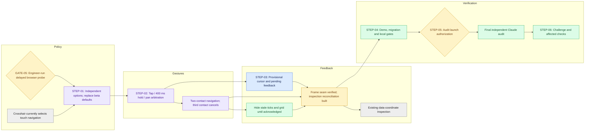

# Touch interaction planning canvas

Session-only working view; the task plan owns decisions. Open with Mermaid preview.
Gray: existing. Blue: proposed. Green: settled. Yellow: gated. Purple: built/verified. Red: reopened.

